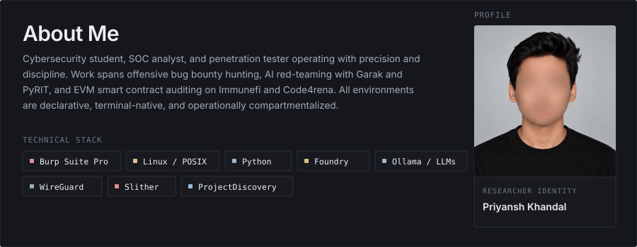
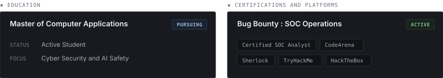
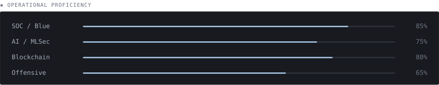
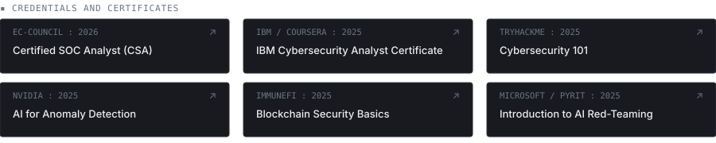
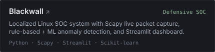
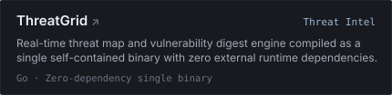
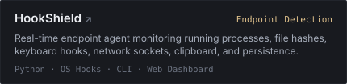
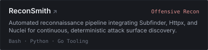

  

  

  

  

  

<code>▪ FEATURED ENGINEERING ARTIFACTS</code>  

<table>
  <tr>
    <td width="50%">
      
    </td>
    <td width="50%">
      
    </td>
  </tr>
  <tr>
    <td width="50%">
      
    </td>
    <td width="50%">
      
    </td>
  </tr>
</table>

View complete repository directory and backlinks

 

| Repository | Scope | Primary Stack | Architecture Summary |
|---|---|---|---|
| [Blackwall](https://github.com/rootwithkhandal/Blackwall) | Defensive SOC | Python, Scapy, Streamlit | Mini-SOC with live packet capture, Isolation Forest ML anomaly detection, and webhook triage. |
| [ThreatGrid](https://github.com/rootwithkhandal/ThreatGrid) | Threat Intel | Go (Zero runtime deps) | Real-time threat map and vulnerability digest compiled as a standalone static binary. |
| [HookShield](https://github.com/rootwithkhandal/HookShield) | Endpoint Detection | Python, OS Hooks, CLI | Real-time endpoint monitor tracking processes, file hashes, hooks, sockets, and persistence. |
| [ReconSmith](https://github.com/rootwithkhandal/reconsmith) | Offensive Recon | Bash, Python, Go Tooling | Deterministic attack surface discovery pipeline integrating Subfinder, Httpx, and Nuclei. |
| [Wazuh SIEM Lab](https://github.com/rootwithkhandal) | Blue Team Automation | Wazuh, n8n, Elastic | Centralized telemetry monitoring with custom Sigma rules and automated API threat enrichment. |
| [Memory Forensics Toolkit](https://github.com/rootwithkhandal) | Incident Response / DFIR | Python, Volatility 3 | Automated triage scripts for memory dump parsing and detection of code injection patterns. |

---

### Verification & Channels

- **Portfolio:** [khandal.tech](https://khandal.tech)
- **GitHub:** [github.com/rootwithkhandal](https://github.com/rootwithkhandal)
- **Direct Contact:** [ipriyansh@outlook.in](mailto:ipriyansh@outlook.in)
- **Research Notes:** [khandal.gitbook.io/writeups](https://khandal.gitbook.io/writeups)
- **Vulnerability Disclosure:** Inquiries and disclosures follow the policy specified on [khandal.tech](https://khandal.tech)

  

